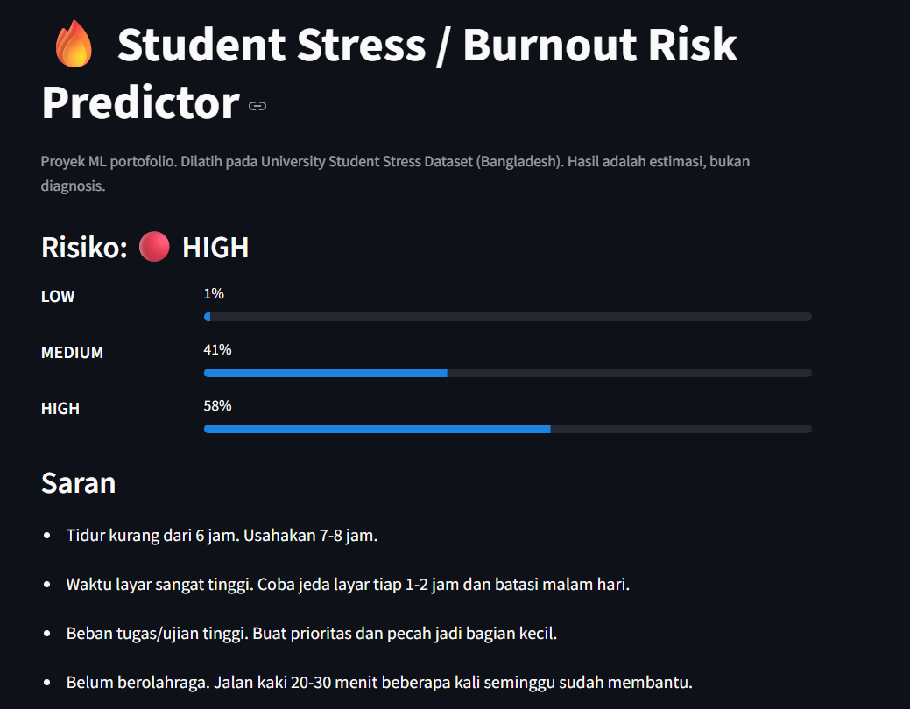

# 🔥 Student Stress / Burnout Risk Predictor


Aplikasi machine learning yang memprediksi **risiko stres mahasiswa** (Low / Medium / High) dari kebiasaan
harian. Pengguna mengisi slider, lalu aplikasi menampilkan **probabilitas tiap kelas (total 100%)** dan
saran sederhana.

> ⚠️ **Disclaimer:** proyek pembelajaran. Hasilnya adalah estimasi statistik, **bukan diagnosis** kesehatan
> mental. Target model adalah *tingkat stres* pada dataset, bukan burnout klinis.



<!-- Setelah deploy, tambahkan: **Demo:** https://NAMA-APP-KAMU.streamlit.app -->

## Fitur
- Pipeline scikit-learn (scaling + encoding + model) dalam satu objek yang disimpan dengan `joblib`
- Perbandingan 3 model (Logistic Regression, Random Forest, Gradient Boosting) dengan Stratified 5-fold CV
  berdasarkan F1-macro; model terbaik dipilih otomatis
- Output probabilitas per kelas yang berjumlah 100%
- Permutation importance dan confusion matrix di folder `reports/`
- Antarmuka Streamlit dan unit test (`pytest`)

## Input dan output

| Input (kebiasaan) | Rentang |
|---|---|
| Jam belajar per hari | 0 - 9 |
| Kehadiran kuliah (%) | 40 - 99 |
| Jam tidur per hari | 4 - 9 |
| Beban tugas | 1 - 9 |
| Frekuensi ujian | 1 - 9 |
| Total waktu layar per hari (jam) | 1 - 11 |
| Media sosial per hari (jam) | 0 - 7 |
| Berolahraga | Yes / No |

Output: probabilitas **Low / Medium / High** dan saran berbasis aturan sederhana (bukan output model).

## Dataset
**University Student Stress Dataset** (mahasiswa S1 di Bangladesh, 3.000 respons), Mendeley Data,
DOI [`10.17632/rc5htd5dfr.1`](https://doi.org/10.17632/rc5htd5dfr.1).

Dataset **tidak disertakan** di repo ini. Unduh dari halaman Mendeley, lalu salin
`Cleaned_Data/university_student_stress_dataset.csv` ke `data/raw/`.

**Sitasi:** Paul, Subrata Kumer; Paul, Rakhi Rani; Musa Miah, Abu Saleh; Hamid, Md. Ekramul ; Rashidul Hasan, Mirza A.F.M.  (2025), “University Student Stress Dataset”, Mendeley Data, V1, doi: 10.17632/rc5htd5dfr.1

Fitur yang dipakai hanya kolom kebiasaan di atas. `Anxiety_Level`, `Family_Support`, `Peer_Pressure`,
demografi, dan kolom ekonomi sengaja tidak dipakai: penilaian psikologis terlalu dekat dengan hasil yang
diprediksi, dan sisanya tidak diperlukan untuk tujuan aplikasi.

## Hasil

Model terpilih: **Logistic Regression**. Akurasi tes ≈ **0.72**, F1-macro ≈ **0.70**.

| Kelas | F1 |
|---|---|
| Low | ≈ 0.80 |
| Medium | ≈ 0.70 |
| High | ≈ 0.59 |

High paling sulit dikenali karena hanya sekitar 11% data dan sebagian penentunya tidak dijadikan input.

Fitur paling berpengaruh (permutation importance, F1-macro):

| Fitur | Importance |
|---|---|
| Screen_Time | 0.203 |
| Assignment_Load | 0.133 |
| Exam_Frequency | 0.110 |
| Social_Media_Use | 0.098 |
| Sleep_Hours | 0.077 |
| Physical_Exercise | 0.039 |
| Class_Attendance | ≈ 0 |
| Study_Hours | ≈ 0 |

Angka lengkap: `reports/metrics.json`, `reports/confusion_matrix.png`.

## Keterbatasan (baca ini)
- **`Stress_Score` pada dataset adalah rumus linear persis dari kolom lain** (R² = 1.0): beban tugas +
  frekuensi ujian + waktu layar + media sosial + anxiety − jam tidur − family support − 2 × olahraga.
  Label Low/Medium/High hanyalah ambang batas skor itu, jadi label bukan hasil pengukuran psikologis.
- **Jam belajar, kehadiran, dan peer pressure tidak ikut dalam rumus.** Model menemukan bahwa keduanya
  tidak berpengaruh. Ini sifat dataset, bukan kesimpulan tentang dunia nyata.
- Nilai tiap kolom tersebar hampir rata (uniform), pola yang lazim pada data yang dibangkitkan acak.
  Cara pengumpulan data tidak dapat saya verifikasi.
- Probabilitas belum dikalibrasi: "58%" adalah keyakinan model, bukan peluang sebenarnya.
- Dokumentasi dataset menyebut `Physical_Exercise` sebagai hari per minggu, tetapi file CSV hanya berisi
  Yes/No; yang dipakai di sini adalah isi CSV.

## Struktur proyek
```
.
├── app.py                 # UI Streamlit
├── burnout/
│   ├── config.py          # fitur, label, path
│   ├── data.py            # loader dataset
│   ├── train.py           # training, CV, evaluasi, simpan model
│   └── predict.py         # predict_risk() + saran
├── tests/test_predict.py
├── models/stress_model.joblib
├── reports/               # metrics.json, confusion_matrix.png
├── docs/screenshot.png
├── data/raw/              # taruh CSV di sini (di-ignore git)
└── requirements.txt
```

## Cara menjalankan
```bash
python -m venv .venv
.venv\Scripts\activate          # Mac/Linux: source .venv/bin/activate
pip install -r requirements.txt

# taruh CSV di data/raw/university_student_stress_dataset.csv
python -m burnout.train         # latih ulang (opsional, model sudah disertakan)
pytest                          # jalankan tes
streamlit run app.py            # buka aplikasi di localhost:8501
```

## Rencana pengembangan
- [ ] Validasi dengan data survei sendiri (anonim, dengan persetujuan responden)
- [ ] SHAP untuk penjelasan per prediksi dan kalibrasi probabilitas
- [ ] Deploy ke Streamlit Community Cloud dan CI dengan GitHub Actions

## Lisensi
Kode: MIT (lihat `LICENSE`). Dataset mengikuti lisensi dan ketentuan sitasi dari penulis aslinya di Mendeley Data.
